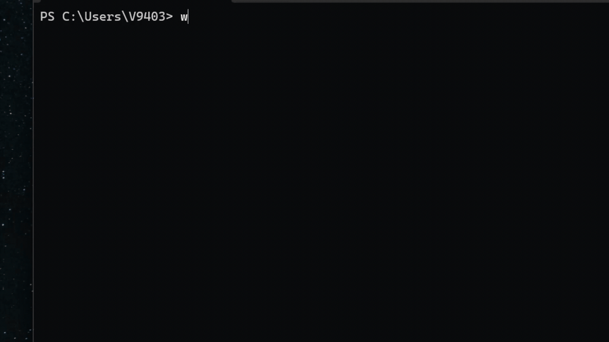
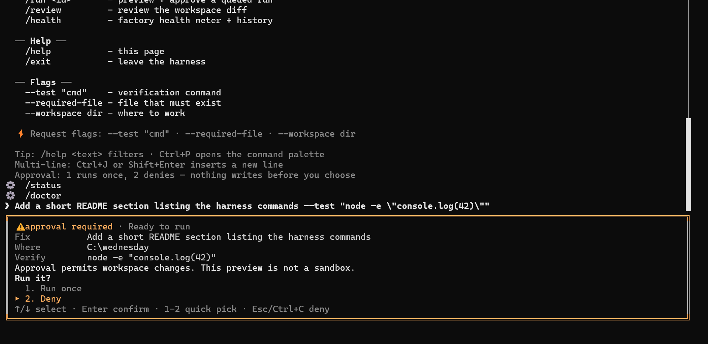
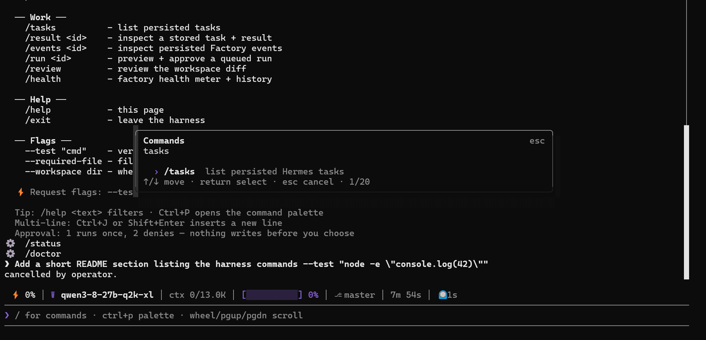
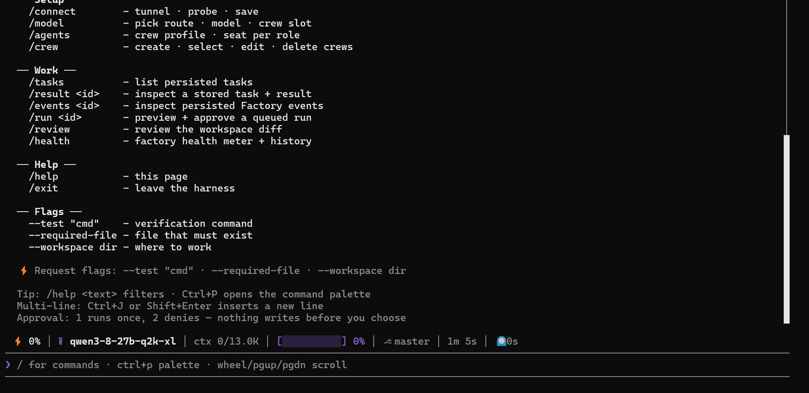

# Wednesday

**One terminal command. A whole engineering team behind it.**

[](https://www.npmjs.com/package/@lab1207/wednesday)
[](https://wednesdaylabs.pages.dev/)
[](LICENSE)
[](package.json)
[](CONTRIBUTING.md#tests)

Wednesday is a free, open-source (Apache 2.0) terminal harness that turns a
plain-language request into planned, verified engineering work. You bring the
model — hosted or running locally on your own hardware — and Wednesday supplies
the structure around it: planning, explicit approval, engineering roles, real
verification, and repair until the tests pass.

**Small open models, staffed as a coding team.**



```bash
npm i -g @lab1207/wednesday@beta
wednesday                # first run: /connect picks a model, then type a request
```

> **Beta.** Version `0.2.0-beta.3`. The terminal app is the product today; the
> desktop IDE is still in development. Beta builds can change at any time.

- **Website:** <https://wednesdaylabs.pages.dev>
- **npm:** <https://www.npmjs.com/package/@lab1207/wednesday>
- **Source:** <https://github.com/lab1207/Wednesday>
- **Issues:** <https://github.com/lab1207/Wednesday/issues>

---

## Why Wednesday

A model on its own guesses. Wednesday wraps it in a process that cannot skip the
checks:

1. **Plan** — your request becomes an objective, a workspace, and files in scope.
2. **Approve** — you see the task preview and the verification command. Nothing
   runs until you say `y`. Piped input never auto-approves.
3. **Build** — engineering roles do the work in a controlled sandbox.
4. **Verify** — real commands run against real files. The model's opinion about
   whether it worked does not count.
5. **Repair** — failures feed back into the loop until the check passes or the
   budget runs out.
6. **Review + receipt** — you see the diff after green, and the run is persisted
   with its evidence.

Every run has a receipt: `/tasks`, `/result`, `/events`, `/run`.



## Install

```bash
npm i -g @lab1207/wednesday@beta   # recommended beta channel
npm i -g @lab1207/wednesday        # latest tag
npm i -g @lab1207/wednesday@dev    # newest commits, may break
npx @lab1207/wednesday@beta        # one-shot, no global install
```

Or from source:

```bash
git clone https://github.com/lab1207/Wednesday.git
cd Wednesday
npm install
npm link                 # `wednesday` on your PATH from this checkout
```

**Requirements:** Node.js **24 or newer** on Windows, macOS, or Linux, and a
model backend — your own OpenRouter/NVIDIA NIM key, or any OpenAI-compatible
server (Ollama, LM Studio, llama.cpp, vLLM) auto-detected in `/connect`.

Remove the command with `npm uninstall --global @lab1207/wednesday`.
Uninstalling leaves your profile data in place; `wednesday uninstall` removes
`~/.wednesday` after an explicit confirmation.

## Try it in five minutes

```bash
mkdir demo && cd demo
npm init -y
wednesday "Create hello.txt containing exactly HELLO_DEMO." \
  --test "node -e \"require('node:assert/strict').equal(require('node:fs').readFileSync('hello.txt','utf8').trim(),'HELLO_DEMO')\"" \
  --required-file hello.txt
```

Review the task preview, press `y`, and watch the stages stream. Windows
PowerShell mis-handles the nested quoting — save the test to `verify.js` and
pass `--test "node verify.js"` instead.

## What a run looks like

```text
❯ Add a quantity input to the cart page.
╭─ Task preview ─────────────────╮
│ Objective, workspace, files…   │
│ Verification: $ node --test    │
╰────────────────────────────────╯
Run this task? [y/N] — y approves, n/Esc rejects
─── coder ───
✓ agent.completed (coder)
✓ verification.completed (tester)
✓ task.completed
test PASS: node --test
```

## The terminal

- Fullscreen TUI with a command palette (`ctrl+p`), pager, and per-seat model picks.
- 21+ slash commands: `/connect`, `/model`, `/create`, `/tasks`, `/result`,
  `/events`, `/run`, `/update`, `/uninstall`, `/onboard`, and more.
- Named teams with roles (planner, coder, vision, worker-N), per-role models,
  and repair budgets — stored as plain JSON in `~/.wednesday/state/crews.json`.
- A daily update check that asks before installing anything.





## Model providers

`/connect` probes the endpoint read-only, lists its models, lets you pick, and
saves the choice to `~/.wednesday/.env` (applied live too).

| Backend | How |
| --- | --- |
| Local models | auto-detect Ollama · LM Studio · llama.cpp · vLLM — no key |
| ngrok / Cloudflare tunnel | paste the tunnel URL |
| Local proxy | anything on `127.0.0.1:18090` |
| Any OpenAI-compatible API | base URL + key + model (DeepSeek, Groq, Together, Mistral, vLLM…) |
| OpenRouter | hosted catalog, `OPENROUTER_API_KEY` |
| NVIDIA NIM | hosted inference, `NVIDIA_API_KEY` |

Keys are saved to `~/.wednesday/.env` on your machine only — never into the
repo, logs, receipts, or the website.

## Local data

| What | Where |
| --- | --- |
| Credentials | `~/.wednesday/.env` |
| Task history | `~/.wednesday/state/tasks.json` |
| Event log | `~/.wednesday/state/events.jsonl` |

Advanced overrides: `WEDNESDAY_STATE_HOME` moves the state directory;
`HERMES_TASKS_PATH` and `FACTORY_EVENTS_PATH` select individual files.
`WEDNESDAY_NO_UPDATE_CHECK=1` disables the daily version notice.

## Open source, and only open source

This repository is the free core — all of it. There is no hidden "pro" build
and no license-flag gating: every feature in the npm package is in this repo,
and everything here is Apache 2.0. Paid or commercial work, if it exists, is
built and released separately and never lands in this repository.

- npm: <https://www.npmjs.com/package/@lab1207/wednesday>
- Website: <https://wednesdaylabs.pages.dev>
- Issues: <https://github.com/lab1207/Wednesday/issues>
- Contributing: [`CONTRIBUTING.md`](CONTRIBUTING.md)
- Roadmap: [`ROADMAP.md`](ROADMAP.md)
- Security: [`SECURITY.md`](SECURITY.md)

## Developing Wednesday itself

```bash
npm install
npx tsx factory/orchestrator/test.ts     # locked dispatch sequence — must PASS
npx tsx factory/security/package-surface-test.ts
npx tsx factory/harness/harness-test.ts  # approval gate + pipeline
```

See `CONTRIBUTING.md` for the full test map, issue/PR rules, and the ground
rules (no secrets, verification stays authoritative).

## Status

**Beta, 2026-11-02.** Terminal harness end to end: fullscreen TUI, approval
gates, team and model routing, central secret redaction, shell-free fenced
tools, and a packaging surface guarded by tests. Next: desktop IDE, public
benchmark ladder, and runtime packs for Linux/macOS.

Licensed under [Apache 2.0](LICENSE). Third-party notices:
[`THIRD_PARTY_LICENSES.md`](THIRD_PARTY_LICENSES.md).
